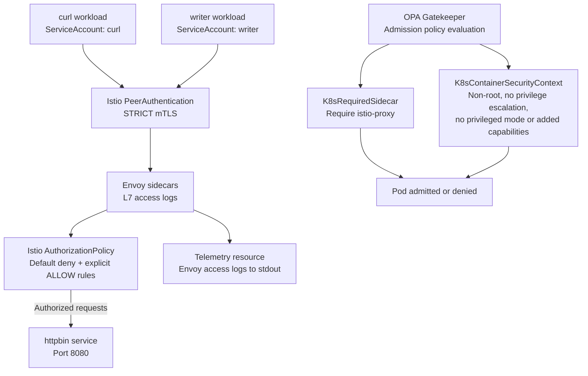

# Phase 7 — Zero Trust Service Mesh Architecture

## Overview

Phase 7 adds Kubernetes runtime security controls to the Enterprise DevSecOps Pipeline. Istio provides workload identity, mutual TLS, service-to-service authorization, and Envoy access telemetry. OPA Gatekeeper enforces admission-time guardrails for required sidecars and container security contexts.

## Architecture

## Implemented Controls

- **STRICT mTLS:** Istio requires mutual TLS for workloads covered by the `phase7-mtls` namespace policy.
- **Workload identity:** Authorization rules use Kubernetes service-account principals.
- **Least-privilege access:** The curl identity is permitted to issue GET requests to httpbin; the writer identity is permitted to issue POST, PUT, and DELETE requests.
- **Default-deny authorization:** An ALLOW policy with no rules blocks requests that do not match another applicable ALLOW policy.
- **L7 telemetry:** Istio Telemetry configures Envoy access logging to stdout.
- **Required sidecar:** Gatekeeper rejects test Pods that omit the `istio-proxy` container.
- **Container security context:** Gatekeeper policies require non-root execution and prohibit privilege escalation, privileged mode, and added Linux capabilities in the scoped test namespace.
- **Negative testing:** Tests demonstrate denied unauthorized requests and rejected noncompliant Pod admissions.

## Scope and Limitations

These controls were validated in a single-node k3s lab running on an AWS EC2 Ubuntu instance. This is a project lab, not a claim of production deployment or multi-node resilience.

Gatekeeper's Rego webhook enforcement and constraint audits were exercised. Gatekeeper reported that its Kubernetes-native validation engine was missing; this remains a documented limitation.

The Gatekeeper test constraints are scoped to `phase7-gatekeeper-test`. Istio mesh controls apply to configured workloads and namespaces, not automatically to every workload in the cluster.
